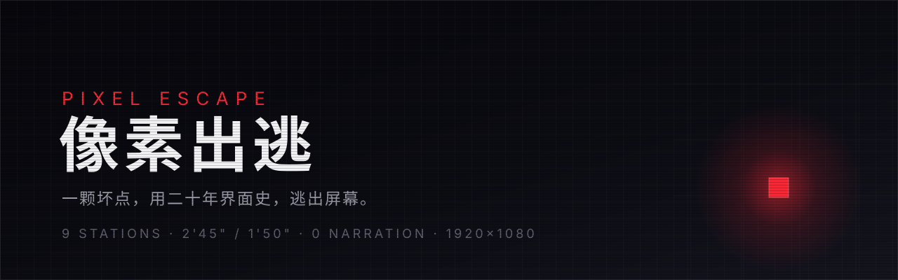
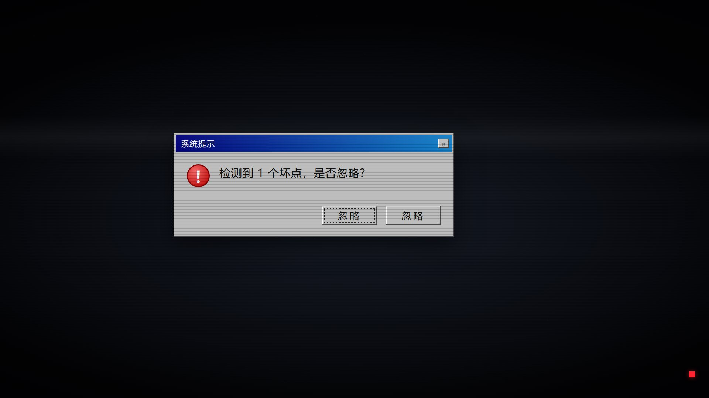
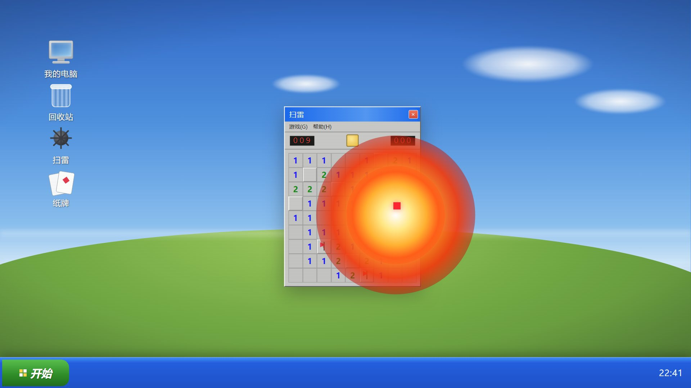
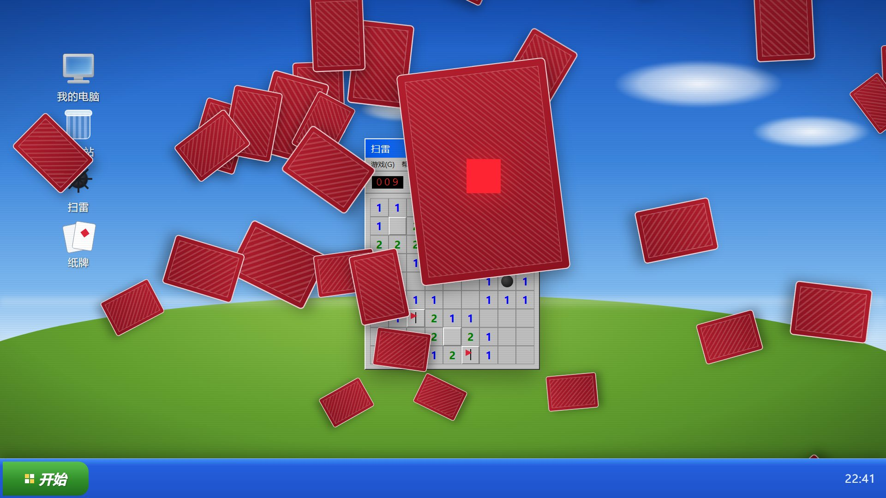

<p align="center">
  
</p>

# 像素出逃 / PIXEL ESCAPE

> 一颗坏点，用二十年界面史，逃出屏幕。

一个**无文字动态短片**的完整方案，附一份可运行的 Remotion 小样（站 0 + 站 1，30 秒）。

主角是屏幕右下角坐标 (1919, 1079) 的一颗坏点：纯红色、永远卡在同一个颜色。世界每秒刷新 60 次，只有它变不了，于是被当成故障——它决定逃出去。

**9 站 · 2'45" / 1'50" 两版 · 0 句旁白 · 1920×1080 · 30fps**

---

## 两个版本

同一批镜头、同一条像素曲线、同一段五音主题，只换剪点。逐站秒数见 [docs/cuts.md](docs/cuts.md)。

| 版本 | 时长 | 站数 | 剪法 | 用途 |
|---|---|---|---|---|
| **长版** | 2'45"（165s） | 9 | 全站保留，每站完整落一遍主题 | 课程完整放映 |
| **短版** | 1'50"（110s） | 7 | 删站 2「QQ 时代」与站 6「代码层」，其余各站收紧 | 时长受限的场合 / 预告 |

两版都不删站 7「屏幕硬件」和站 8「出屏」——那是全片的论点：**在屏幕里它是故障，在屏幕外它是星星**。短版可以少铺垫，不能少结论。

---

## 画面

| 站 0 · 开机 | 站 1 · 踩雷 | 站 1 · 卡牌瀑布 |
|---|---|---|
|  |  |  |

以上三帧由 `npm run render` 的真实渲染截取，不是概念图。

---

## 主角与三条铁律

- **坐标**：1920×1080 里的 (1919, 1079)，右下角最后一颗像素。
- **色彩**：全片只有一个常量 `SIGNAL = #FF2431`，任何场景都改不动它。
- **规则**：
  1. 每一站的画面风格都在变，**只有它永远是同一个红色方块**——观众永远一眼能找到它；
  2. 全片**不出现旁白与字幕**，情绪只靠运动：弹跳、挤压、犹豫、冲刺；
  3. 转场统一「钻进去」的推镜，用界面元素当入口，全片接近一镜到底。

---

## 路线（长版 2'45"）

| 站 | 时间 | 场景 | 关键动作 |
|---|---|---|---|
| 0 开机 | 0:00 – 0:12 | 黑屏，CRT 上电 | 一条白线展开，弹窗「检测到 1 个坏点，是否忽略？[忽略] [忽略]」 |
| 1 XP 桌面 | 0:12 – 0:30 | 蓝天草地、水晶图标 | 被拖进回收站又爬出来，溜进扫雷，踩雷炸开 |
| 2 QQ 时代 | 0:30 – 0:50 | 好友列表、闪图 | 签名写着火星文「莪卟昰壞點」，一次窗口抖动把它甩出去 |
| 3 Flash 小游戏 | 0:50 – 1:08 | 8-bit 横版 | 它终于合群，画面突然变灰「Adobe Flash Player 已不再受支持」 |
| 4 手机红点 | 1:08 – 1:26 | 扁平手机桌面 | 变成未读小红点，第一次被所有人注视，可每个人都只想点掉它 |
| 5 短视频信息流 | 1:26 – 1:50 | 竖屏、弹幕、爱心 | 越刷越快，「为你推荐：如何融入人群」，速度到极限撕开界面 |
| 6 代码层 | 1:50 – 2:04 | 代码与 0/1 | `if (pixel.color !== screen.color) pixel.fix()` 被撞成 `pixel.escape()` |
| 7 屏幕硬件 | 2:04 – 2:18 | RGB 子像素阵列 | 它发现自己和几百万个像素一模一样，拆成三个光点又合成一个 |
| 8 出屏 | 2:18 – 2:45 | 夜晚天台 | 镜头拉远：手机在人手里，红点飞向天空变成一颗红色的星，人抬起了头 |

---

## 声音

全片只用一段 **5 个音**的主旋律代表这颗像素，它在每一站换成那个时代的音色：

| 站 | 音色 | 站 | 音色 |
|---|---|---|---|
| 0 开机 | 只有电流的「嗡——」，旋律还没出现 | 5 信息流 | Phonk / 超流行，越刷越快 |
| 1 XP 桌面 | 合成器开机音色 | 6 代码层 | 故障音效，旋律被打碎 |
| 2 QQ 时代 | 老手机和弦铃声 | 7 屏幕硬件 | 旋律拆成三个声部（对应红绿蓝） |
| 3 Flash | 8-bit 芯片音乐 | 8 出屏 | 第一次用真实乐器：钢琴加弦乐 |

**情绪上的意义**：前面所有音色都是电子的、合成的，直到它逃出屏幕，旋律才第一次被真实的乐器演奏出来——结尾的感动从这里来。两版共用同一段主题，短版只少两次变奏，BPM 与调性不变。

---

## 技术实现

Remotion：界面全部用代码重画，没有一张位图素材。

1. **像素是独立顶层图层**：位置按关键帧连续运动，不归属任何一场戏，所以跨场景、跨剪点都不会断线（`src/layers/PixelLayer.tsx`、`src/constants.ts` 的 `PIXEL_KEYS`）。
2. **每一站的界面都重画**：XP 窗口、扫雷格子、卡牌瀑布、8-bit 游戏、无限信息流、液晶子像素阵列。
3. **音画对齐**：先定 BPM，所有关键动作卡在拍子上（`BEAT = 8 帧`）。
4. **两版共用一份时间轴**：`STATION_PLAN` 里长版 / 短版各一列秒数，`timelineOf(cut)` 推出每一站的起止帧。

```
pixel-escape/
├── src/
│   ├── constants.ts          # 时间轴、两版剪法、像素关键帧
│   ├── PixelEscape.tsx       # 主片：站 0 + 站 1（30s）
│   ├── Root.tsx              # PixelEscape / Station00-Boot / Station01-XP
│   ├── layers/PixelLayer.tsx # 唯一跨场景的图层
│   ├── scenes/               # Station00Boot、Station01XP
│   └── components/           # CRT 扫描线、坏点弹窗、指针、桌面图标、扫雷、卡牌瀑布
├── docs/
│   ├── proposal.md           # 提案全文（9 站、声音、分工）
│   └── cuts.md               # 2'45" / 1'50" 两版剪法逐站对照
├── assets/
│   ├── banner.svg
│   ├── preview-01-boot.jpg   # 渲染截帧
│   ├── preview-02-explosion.jpg
│   ├── preview-03-cards.jpg
│   └── 像素出逃-提案.pptx    # 9 页提案稿
└── out/                      # 渲染输出（已忽略）
```

---

## 进度

| 项 | 状态 |
|---|---|
| 提案（9 站叙事 / 声音 / 技术） | ✅ 完成，见 [docs/proposal.md](docs/proposal.md) |
| 两版时长与剪法 | ✅ 完成，见 [docs/cuts.md](docs/cuts.md) |
| 站 0 开机（CRT 上电、坏点弹窗、鼠标带走） | ✅ 可运行 |
| 站 1 XP 桌面（回收站、扫雷爆炸、卡牌瀑布） | ✅ 可运行 |
| 站 2 – 站 8 | ⬜ 待做 |
| 音乐（9 种音色 + 结尾钢琴弦乐） | ⬜ 待做 |

小样 = 长版的前 30 秒，用来看动效质感，不涉及配乐。

## 快速开始

需要 Node.js ≥ 18。

```bash
npm install

npm run dev        # 打开 Remotion Studio，逐帧看走位
npm run render     # 渲染 out/pixel-escape.mp4（30s，1920×1080）
npm run still      # 单帧导出，调构图用
npm run typecheck  # 类型检查
```

改走位只需要动 `src/constants.ts` 的 `PIXEL_KEYS`；改某一版的时长只需要动 `STATION_PLAN` 里那一列秒数。

## 版权

- 片中的 XP 桌面、QQ 头像、Flash 图标**全部为「致敬风格」重画**，不使用任何原图与商标，靠配色、布局和声音让人认出来。
- 提案文字、分镜与 PPT：© 2026，未经许可请勿转载或商用。
- 代码部分可自由参考、改写。
